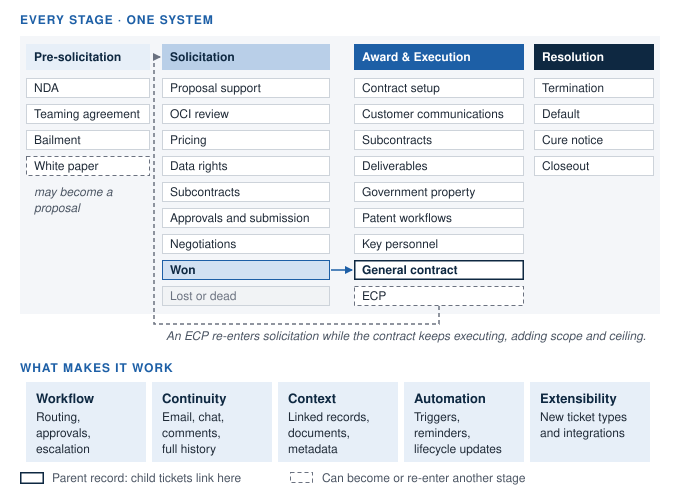
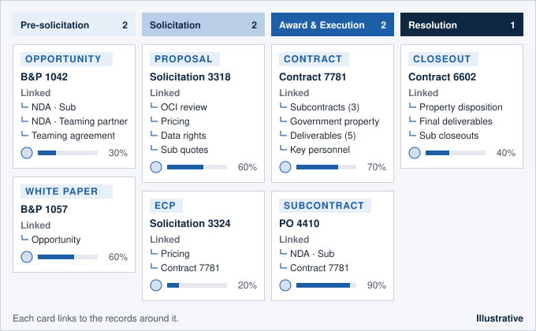
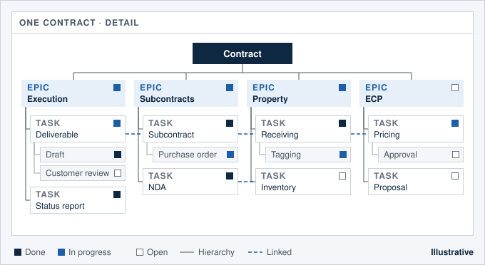
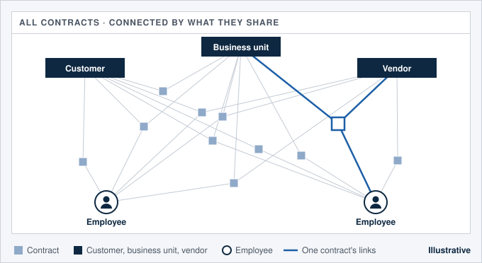
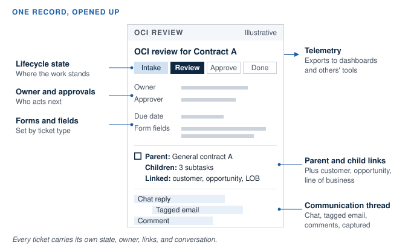
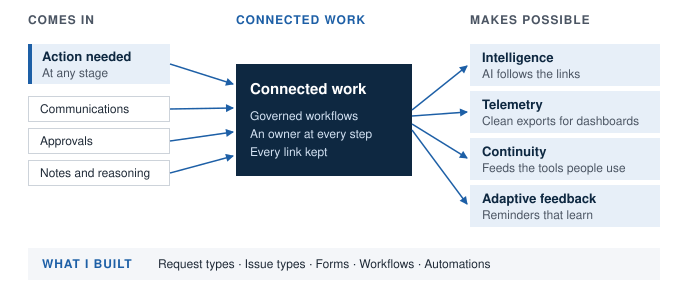

[Portfolio home](../../README.md) · [Operational topology](../../03-topology/README.md) · [Demonstrations](../../02-demos/README.md)

# Contract Lifecycle Orchestration

Contract work doesn’t just live in a document. It lives in the questions, approvals, decisions, and handoffs around it.

I designed the contract as a connected system, so every action keeps its context and can be traced across the full lifecycle.

---

## System Map

---

## **Outcomes**

- Every request, approval, communication, and decision captured in one connected system
- Centralized tracking for requests, approvals, communications, dates, ownership, and status
- Continuously visible lifecycle state across proposals, contracts, modifications, and closeout activity
- Automated reminders and routing to reduce follow-up burden
- Slack-connected execution with responses captured back into the system
- API-enabled reporting feeding Power BI dashboards

---

## Case Brief

[ExecB-Contracts.pdf](case-brief.pdf)

---

## **The Problem**

Many contract tools store documents and metadata, but the work around the contract still happens elsewhere: email, Slack, shared drives, proposal files, spreadsheets, meetings, and individual memory.

That makes it difficult to see where contract work stands, who owns the next step, what changed, what was communicated, and how related records connect.

---

## **What Makes It Different**

Traditional CLMs primarily manage documents and metadata.

This system manages the work around the contract: requests, reviews, approvals, deadlines, communication, ownership, exceptions, and lifecycle state.

Records can branch, re-enter, inherit metadata, and preserve relationships over time. A white paper may become a proposal. A proposal may become a contract. An active contract may re-enter the cycle through an ECP or modification.

<aside>

**The important point:** communication and context do not disappear into email or chat. They become part of the governed execution history.

</aside>

### How Contract Work Moves

### What the System Tracks

---

---

## Lightweight Infrastructure

Built to scale through light structures and connected workflows, not added overhead.

---

### How This Connects

This system functions as the lifecycle orchestration layer for contract activity. It connects opportunity, proposal, review, award, execution, distress, and closeout work into a single governed operating structure.

It supports the broader operational topology by preserving communication continuity, maintaining visible lifecycle state, and converting fragmented contract activity into traceable operational history.

Explore →

[Operational Topology](../../03-topology/README.md)

---

[View this story in the visual portfolio](https://courtneypetersonchapman.notion.site/sys-contract).
