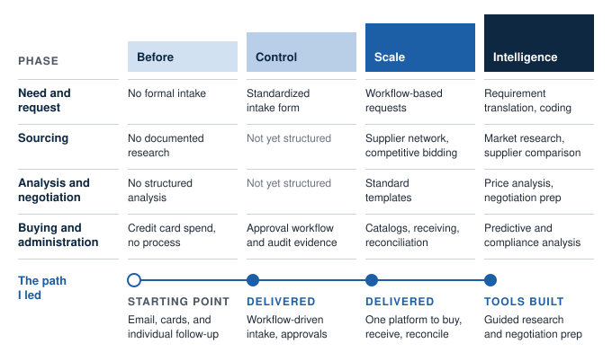
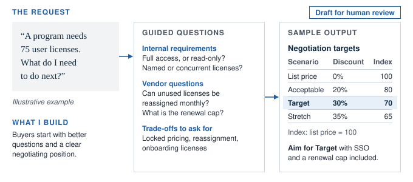
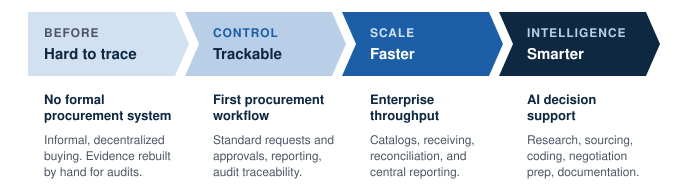
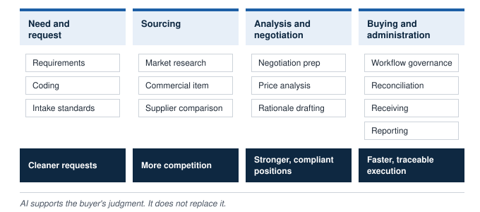

[Portfolio home](../../README.md) · [Operational topology](../../03-topology/README.md) · [Demonstrations](../../02-demos/README.md)

# Procurement Operating Model

Procurement is where organizational need becomes a controlled purchase.

This system was built to move buying activity out of email, credit cards, and manual follow-up into a structured process with intake, approvals, sourcing support, receiving coordination, reporting, and audit evidence.

---

## System Map

---

## Outcomes

- Government-validated purchasing system
- Millions in managed spend during the first operating year
- Thousands of micro-purchases processed through punch-out catalogs
- ~75% reduction in procurement cycle time
- AI-assisted support embedded throughout the buying lifecycle

### System In Action

---

## Case Brief

[ExecB-Procurement.pdf](case-brief.pdf)

---

## The Problem

The organization scaled quickly, but procurement operations were still fragmented. Requests, approvals, vendor information, receiving, and documentation were spread across email, credit cards, and individual follow-up.

The system had to support live purchasing while the process, controls, reporting, and audit trail were still being built.

The goal was not just faster buying. The goal was a buying process people could follow, track, audit, and improve.

---

## How the Buying Process Matured

> *"Buying became trackable, auditable, faster, and smarter."*
>

The procurement function evolved through four phases, each solving a different operating problem.

---

## How It Helps Buyers

> *"Better inputs. Better analysis. Better negotiations. Better execution."*
>

---

## Lightweight Infrastructure

Built to scale through light structures and AI-assisted work, not added overhead.

---

### How This Connects

This system governs acquisition workflows, sourcing, approvals, receiving coordination, and financial traceability before accountability transitions into lifecycle governance under the Government Property operating model.

Explore →

---

[Operational Topology](../../03-topology/README.md)

[View this story in the visual portfolio](https://courtneypetersonchapman.notion.site/sys-procurement).
