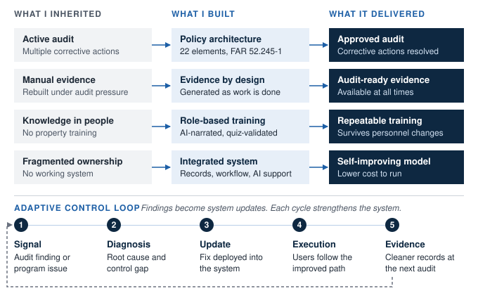
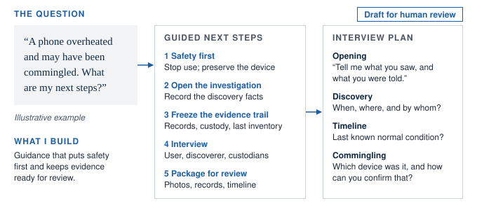
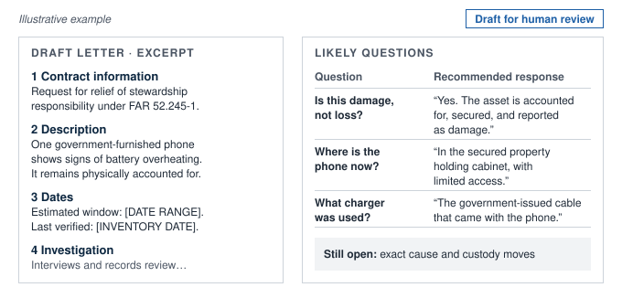
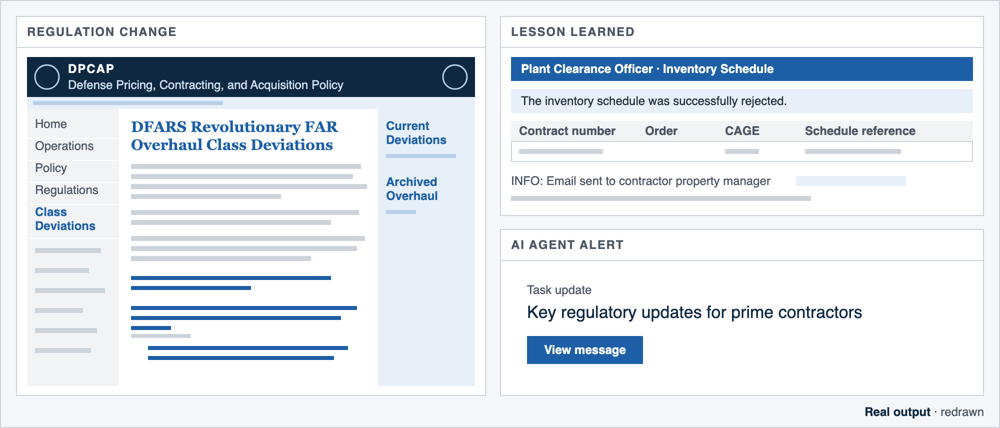
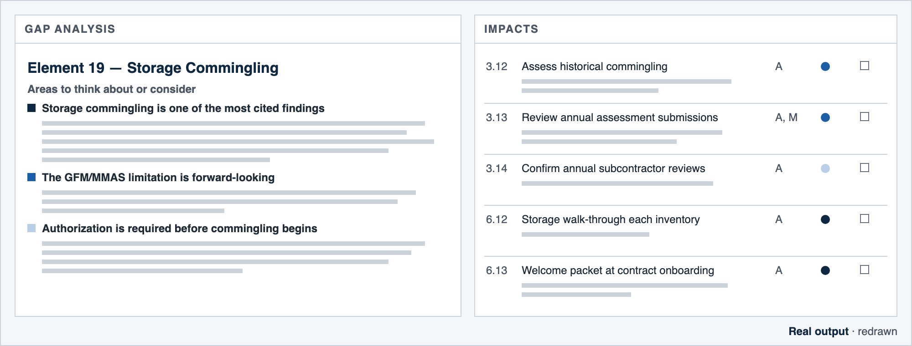
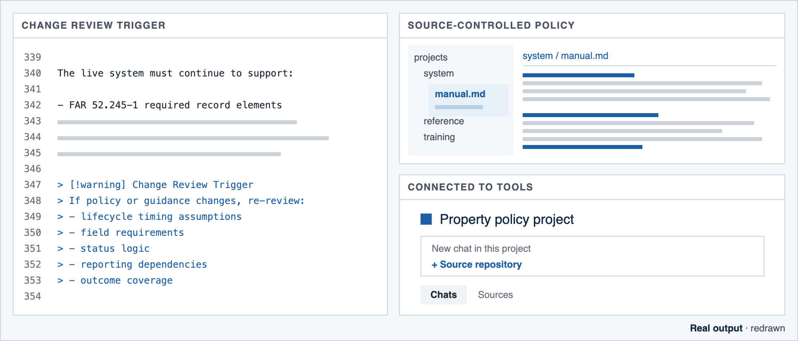
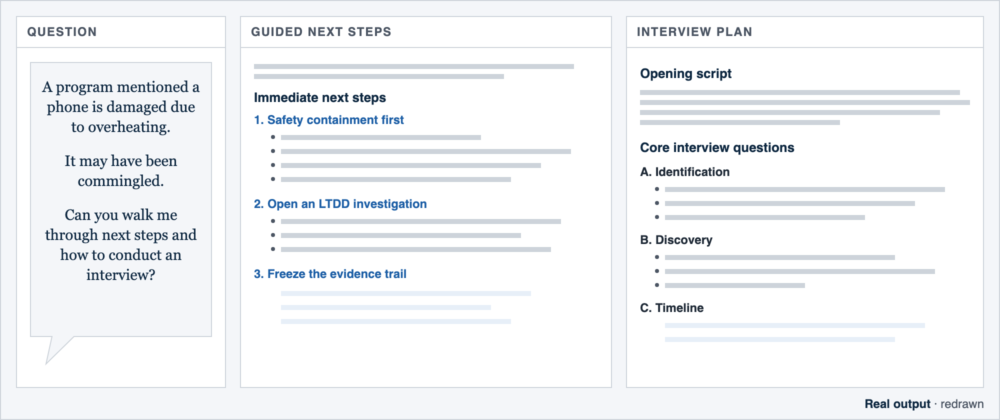
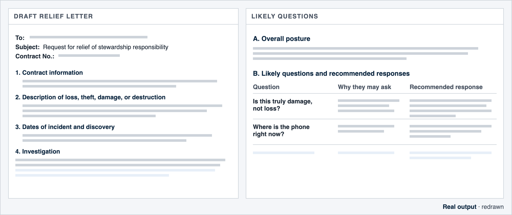
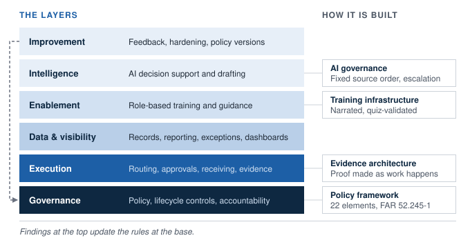
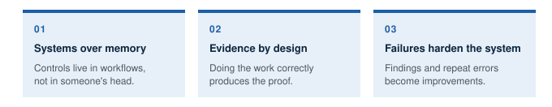

[Portfolio home](../../README.md) · [Operational topology](../../03-topology/README.md) · [Demonstrations](../../02-demos/README.md)

# Adaptive Government Property System

Government Property is not just asset tracking. In a federal environment, it is the control system for proving where property is, who is accountable for it, what happened to it, and whether the organization can support that with evidence.

This system was built to make that work repeatable, visible, and audit-ready instead of dependent on individual memory.

---

## System Map

---

## Outcomes

- **AUDIT OUTCOME**: Approved PMSA (audit) & resolved corrective actions (CAR)
- **OPERATIONAL CONTROL**: Audit ready evidence at all times
- **TRAINING**: Repeatable, AI-narrated and modularized
- **OPERATING MODEL**: Lower-cost, self-improving system

### System In Action

---

## Case Brief

[ExecB-Property.pdf](case-brief.pdf)

---

## The Problem

The Government Property function was inherited during an active audit with multiple corrective actions and no reliable operating model.

The practical problem was simple: evidence was hard to assemble, ownership was fragmented, training was limited, and too much compliance knowledge lived in people’s heads.

The solution was to redesign the function so policy, workflows, records, evidence, training, reporting, and AI-assisted support worked together instead of operating as disconnected pieces.

---

## Adaptive Control Loop

> *“Findings become system updates, not one-off fixes. Each cycle strengthens the system.”*
>

### System will Self-Improve

#### **01 · Signal:** Compliance flag or program issue

Audit finding, recurring issue, regulation change, inventory discrepancy, or execution gap becomes system input.

#### **02 · Diagnosis:** Root cause and control gap

The control gap is identified: workflow, guidance, training, ownership, evidence, or system design.

#### **03 · Update:** System hardened

The fix is deployed into policy, workflows, templates, training, reporting, or AI guidance so the improvement becomes part of the operating system itself.

#### **04 · Execution:** Users follow improved path

Users follow the improved operational path with embedded controls and automatically generated evidence.

#### **05 · Evidence:** Audit-ready output

The next audit encounter reflects the improvement through cleaner records, stronger traceability, and fewer repeat issues.

---

## How the System Works

---

## Lightweight Infrastructure

Built to scale through light structures and AI-assisted work, not added overhead.

### Design Principles

---

### How This Connects

Part of the operational topology: from acquisition to lifecycle accountability.

Explore →

[Operational Topology](../../03-topology/README.md)

---

[View this story in the visual portfolio](https://courtneypetersonchapman.notion.site/sys-property).
