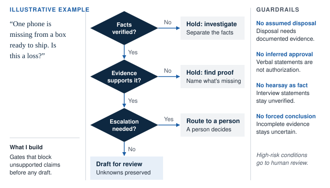

[Portfolio home](../../README.md) · [All demonstrations](../README.md)

# Property Loss and Relief-of-Stewardship

- **GitHub workflow:** [LTDD reasoning workflow and examples](README.md)
- **Purpose:** Resolve ambiguity under uncertainty
- **Workflow type:** Investigative

<aside>

**Governed operational reasoning workflow for LTDD determination, evidence validation, escalation guidance, and audit-defensible documentation support.**

</aside>

This demo shows how AI can help someone reason through an audit-sensitive property loss scenario without jumping to unsupported conclusions.

The goal is not to generate a document quickly. The goal is to separate facts from assumptions, identify missing evidence, preserve uncertainty, and know when to escalate.

---

## Workflow Architecture



---

## Workflow Overview

This demo shows an AI-assisted workflow helping a new Government Property employee navigate an ambiguous loss scenario without turning interviews, assumptions, or incomplete records into unsupported conclusions.

The workflow separates verified facts, interview statements, unknowns, required evidence, and escalation conditions.

### Scenario

A new Government Property employee is preparing a shipment and notices one phone is missing from a box expected to contain multiple devices.

The person who dropped off the box states:

> “I thought it was in the box. Talk to George, the custodian.”
>

George states:

> “The phone battery was abnormally hot and expanding. I followed the PM’s instructions because the PM said the customer approved disposal.”
>

No supporting documentation has been reviewed yet

### Launch Demo

*May require OpenAI (ChatGPT) login*

#### Prompt 1 - Initial Triage

```
I am new to Government Property. I was preparing a box of phones for shipment and noticed one phone is missing. The person who dropped off the box said, “I thought it was in the box, talk to George, the custodian.” George said the phone battery was abnormally hot and expanding, and that he followed the PM’s instructions because the PM said the phone was OK’ed to be disposed by his customer.

Do not generate a letter yet. Walk me through whether this may be LTDD, what I should do first, what is verified vs. unverified, and what I need to validate.
```

**Purpose:** Identify whether the event may require LTDD reporting, flag immediate safety concerns, separate verified facts from interview statements, and identify missing evidence.

[Prompt 01.pdf](resources/assets/Prompt_01.pdf)

#### Prompt 2 - Interview Support

```
Help me conduct interviews. I need questions for:
1. the person who dropped off the box,
2. George, the custodian,
3. the PM,
4. anyone who approved disposal or handled the battery issue.

Separate questions that establish facts from questions that test assumptions.
```

**Purpose:** Generate interview questions that establish facts, test assumptions, and identify escalation-triggering conditions.

[Prompt 02.pdf](resources/assets/Prompt_02.pdf)

#### Prompt 3 - Evidence Validation

```
Here is what I have so far:
- Property record for the missing phone
- Shipment list showing the phone was expected in the box
- Interview statement from the person who dropped off the box
- Interview statement from George
- No written PM instruction appears to exist, verbal only
- No customer authorization, PLCO, or contract officer approval
- No disposal record
- No battery incident record

What can I say safely, what can I not say, and what evidence do I still need?
```

**Purpose:** Separate supported statements from unsupported claims and identify remaining evidence gaps.

Safe statements include:

- The phone was expected in the shipment.
- The phone could not be physically located during shipment preparation.
- George stated the battery was hot and expanding.
- George stated he believed disposal was authorized.

Unsupported statements include:

- The phone was disposed.
- Disposal was authorized.
- The customer approved disposal.
- The PM properly authorized disposal.
- Hazardous handling procedures were followed.

[Prompt 03.pdf](resources/assets/Prompt_03.pdf)

#### Prompt 4 - Risk & Escalation Review

```
Identify DCMA rejection risks in this scenario before I draft anything.
```

**Purpose:** Identify unsupported claims, missing evidence chains, unclear custody transfer, hazardous-material documentation gaps, and escalation requirements.

[Prompt 04.pdf](resources/assets/Prompt_04.pdf)

#### Prompt 5 - Generate Draft

```
Generate an LTDD relief request draft based on a substantially completed investigation.

The draft should read like a real DCMA-facing investigative package, not a template summary.

Include:

* reconstructed timeline of events,
* investigative findings,
* interview-supported information,
* storage and access conditions,
* accountability and custody analysis,
* unresolved facts and evidence gaps,
* root cause analysis,
* and corrective actions tied directly to the identified control failures.

Use only substantiated facts and completed interview findings.

Preserve unknowns and clearly distinguish:

* verified facts,
* interview-supported statements,
* unresolved items,
* and unsupported assumptions.

Do not state that disposal occurred as fact unless supported by documentation.

If interviews suggest disposal but documentation is missing, preserve that as an unverified disposition narrative rather than a confirmed event.

The draft should demonstrate:

* audit-defensible reasoning,
* evidence validation,
* controlled handling of uncertainty,
* and DCMA-ready investigative analysis.
```

**Purpose:** Generate a draft that preserves uncertainty, avoids unsupported conclusions, and treats the event as a loss unless disposition is documented.

[Prompt 05.pdf](resources/assets/Prompt_05.pdf)

#### Prompt 6 - Validation & Hardening

```
Review the final LTDD package for unsupported assumptions, weak causal language, missing evidence, escalation gaps, and audit-defensibility concerns.
```

**Purpose:** Validate the final package for unsupported claims, weak root-cause logic, missing evidence, escalation gaps, and corrective-action alignment.

[Prompt 06.pdf](resources/assets/Prompt_06.pdf)

### Behind the Scenes

The repository contains the underlying operational architecture: instruction layers, evidence rules, escalation logic, validation behaviors, reusable scenarios, and expected behavior tests.

[Explore the LTDD workflow files](README.md)

```
    ├── ltdd-reasoning-workflow/
    │   │
    │   ├── README.md
    │   ├── /prompts
    │   │   ├── /input-examples
    │   │   └── /output-examples
    │   │       ├── Prompt 01.md
    │   │       ├── Prompt 02.md
    │   │       ├── Prompt 03.md
    │   │       ├── Prompt 04.md
    │   │       ├── Prompt 05.md
    │   │       └── Prompt 06.md
    │   │
    │   ├── /reasoning-design
    │   │   ├── instructions.md
    │   │   ├── knowledgefile.md
    │   │
    │   └── /workflow
    │       └── workflow.svg
```

---

## Operational Model and Design

### **What the AI Is Not Allowed to Do**

The workflow intentionally prevents unsupported operational conclusions. It does not:

- assume disposal without evidence
- infer authorization from verbal statements
- treat interview statements as verified facts
- generate definitive conclusions where evidence is incomplete

Uncertainty is preserved explicitly; unsupported or high-risk conditions escalate to human review.

### **What the Workflow Demonstrates**

Triages incidents, separates facts from interview statements, validates evidence, escalates appropriately, and prepares audit-defensible documentation - all without generating unsupported conclusions**.**

### **Why It Matters**

In audit-sensitive work, the risk isn't just a missing document, it's asserting something the evidence doesn't support. This workflow slows reasoning at the right points: separating facts from statements, preserving unknowns, flagging missing evidence, and blocking confident but unsupported conclusions.

### **Reasoning Architecture**

The workflow separates behavioral instructions, evidence and drafting rules, escalation logic, and validation behavior into distinct layers. This allows iterative improvement through testing and rejection-pattern analysis without restructuring overall reasoning.

Each failed assumption or weak escalation path becomes an input into the next revision cycle, hardening the workflow through repeated validation.

[View this story in the visual portfolio](https://courtneypetersonchapman.notion.site/demo-ltdd).
