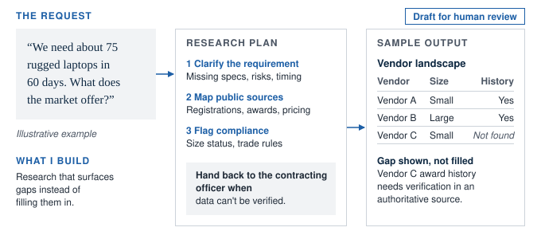

[Portfolio home](../../README.md) · [All demonstrations](../README.md)

# Market Research

- **GitHub workflow:** [Market research workflow and examples](README.md)
- **Purpose:** Structure fragmented public information
- **Workflow type:** Research

<aside>

**Data-source orchestration workflow for federal market research, price benchmarking, vendor discovery, and compliance-aware sourcing support.**

</aside>

This demo shows how AI can help structure federal market research without fabricating vendor data, overclaiming compliance status, or replacing compliant judgment.

The goal is not to produce a quick supplier list. The goal is to organize public market data into a usable research package that supports price reasonableness, sourcing strategy, and acquisition decision support.

---

## Workflow Architecture



---

## Workflow Overview

The workflow separates research intake, public data-source mapping, compliance flagging, and output structure.

The system is designed to surface available information, identify gaps, and direct users to authoritative systems when data cannot be verified.

### Scenario

Engineering requests approximately 75 ruggedized laptops for a new program. Requirements are incomplete, delivery is needed within 60 days, and procurement needs market research to support acquisition planning.

### Launch Demo

*May require OpenAI (ChatGPT) login*

#### Prompt 1 - Requirement Clarification

```
We need approximately 75 ruggedized laptops for field deployment.

Current information:

* Budget target approximately $180,000
* Delivery needed within 60 days
* Federal contractor environment
* Personnel travel frequently
* Multiple peripherals required

Identify missing requirements, acquisition risks, and information needed before market research begins.
```

**Purpose:** Transforms a vague request into a structured acquisition requirement.

[Prompt 01.pdf](resources/assets/Prompt_01.pdf)

#### Prompt 2 - **Market Research Strategy**

```
Using the available information, create a market research strategy, evaluation framework, and recommended research approach.
```

**Purpose:** Creates a repeatable market research methodology before vendor evaluation begins.

[Prompt 02.pdf](resources/assets/Prompt_02.pdf)

#### Prompt 3 - **Market Research Package**

```
Generate a market research summary suitable for acquisition planning including vendor landscape, evaluation criteria, risks, and recommendations.
```

**Purpose:** Converts research into acquisition-ready documentation.

[Prompt 03.pdf](resources/assets/Prompt_03.pdf)

### Behind the Scenes

The repository contains the underlying workflow architecture: source-mapping logic, compliance guardrails, structured output design, missing-data handling rules, and reusable federal market research patterns.

[Explore the market research workflow files](README.md)

```
├── market-research/
│   │
│   ├── README.md
│   │
│   ├── /workflow
│   │   └── workflow.svg
│   │
│   ├── /reasoning-design
│   │   ├── instructions.md
│   │   └── knowledgefile.md
│   │
│   └── /demonstrations
│       ├── intake-and-requirements.md
│       ├── source-mapping.md
│       ├── compliance-flagging.md
│       ├── primary-output-table.md
│       └── vendor-detail-table.md
```

---

## Operational Model and Design

### **What It Demonstrates**

Orchestrates public-source research into a repeatable process. Surfaces vendor data, pricing benchmarks, compliance indicators, and socioeconomic status as decision-support inputs, not procurement conclusions.

### **Why It Matters**

Federal market research means fragmented public systems, inconsistent pricing visibility, and incomplete vendor data. This workflow structures public-source research into a repeatable process (supporting price reasonableness analysis, sourcing visibility, and acquisition planning) without fabricating or over-interpreting unavailable data.

---

[View this story in the visual portfolio](https://courtneypetersonchapman.notion.site/demo-marketresearch).
