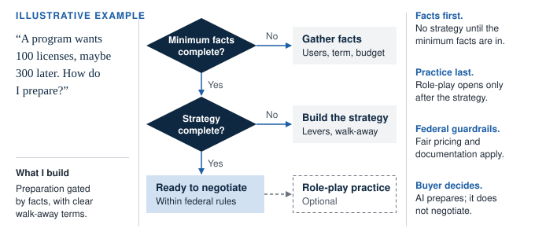

[Portfolio home](../../README.md) · [All demonstrations](../README.md)

# Negotiation Strategy

- **GitHub workflow:** [Negotiation strategy workflow and examples](README.md)
- **Purpose:** Develop governed execution strategy
- **Workflow type:** Preparatory

<aside>

**Phase-gated negotiation preparation workflow for SaaS procurement, federal guardrail awareness, vendor questioning, strategy development, and optional role-play practice.**

</aside>

This demo shows how AI can help a federal buyer prepare for a SaaS negotiation before entering a vendor conversation.

The goal is not to negotiate for the buyer. The goal is to structure preparation: gather minimum facts, identify vendor questions, define negotiation levers, preserve federal procurement constraints, and establish walk-away conditions.

---

## Workflow Architecture



---

## Scenario

A program wants to purchase software licenses for a new effort.

Current estimate:

- 100 users at award
- Potential expansion to 300 users over three years
- Direct purchase from vendor
- Annual licensing model
- Unknown volume discount structure
- Procurement wants to maximize pricing leverage before negotiations begin

### Launch Demo

*May require OpenAI (ChatGPT) login*

#### Prompt 1 - **Internal Discovery**

```
A program wants to purchase software licenses directly from the vendor.

Current estimate:

* 100 users initially
* Potential growth to 300 users
* Three-year program
* Annual subscription licensing

Before engaging the vendor, identify the questions Procurement should ask the internal team to understand requirements, future growth, usage assumptions, budget constraints, and negotiation leverage.
```

**Purpose:** Identifies information needed before engaging the vendor.

[Prompt 01.pdf](resources/assets/Prompt_01.pdf)

#### Prompt 2 - **Vendor Discovery**

```
Based on the information gathered from the program team, generate a list of questions Procurement should ask the software vendor.

Focus on:

* volume pricing
* growth discounts
* multi-year commitments
* license tiers
* training
* implementation support
* renewal protections
* future expansion
```

**Purpose:** Builds a structured vendor discovery plan.

[Prompt 02.pdf](resources/assets/Prompt_02.pdf)

#### Prompt 3 - **Negotiation Preparation**

```
Using the information gathered from internal stakeholders and the vendor, build a negotiation strategy.

Include:

* negotiation objectives
* pricing opportunities
* volume discount opportunities
* future expansion considerations
* contract terms
* renewal protections
* risks
* fallback positions
```

**Purpose:** Creates a structured negotiation strategy before supplier discussions begin.

[Prompt 03.pdf](resources/assets/Prompt_03.pdf)

### Behind the Scenes

The repository contains the underlying workflow architecture: phased reasoning controls, federal procurement guardrails, negotiation constraints, role-play conditions, and reusable SaaS negotiation patterns

[Explore the negotiation strategy workflow files](README.md)

```
├── negotiation-strategy/
│   │
│   ├── README.md
│   │
│   ├── /workflow
│   │   └── workflow.svg
│   │
│   ├── /reasoning-design
│   │   ├── instructions.md
│   │   └── knowledgefile.md
│   │
│   └── /demonstrations
│       ├── phase-01-requirements.md
│       ├── phase-02-vendor-questions.md
│       ├── phase-03-strategy.md
│       ├── phase-04-advanced-suggestions.md
│       └── phase-05-roleplay.md
```

---

## Operational Model and Design

### **What It Demonstrates**

Uses a phase-gated structure: strategy first, role-play only after. Covers SaaS procurement coaching, federal negotiation guardrails, vendor questions, leverage identification, and walk-away conditions.

### **Why It Matters**

Most SaaS negotiation guidance assumes commercial contracting norms. Federal procurement adds constraints (appropriations, fair and reasonable pricing, FAR commercial item protections, acquisition documentation) that standard coaching ignores. This workflow structures preparation within those constraints while preserving buyer judgment.

---

[View this story in the visual portfolio](https://courtneypetersonchapman.notion.site/demo-negotiation).
