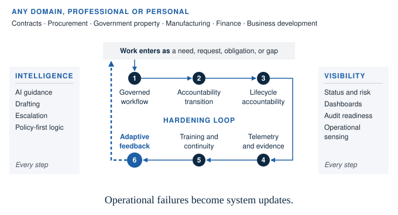
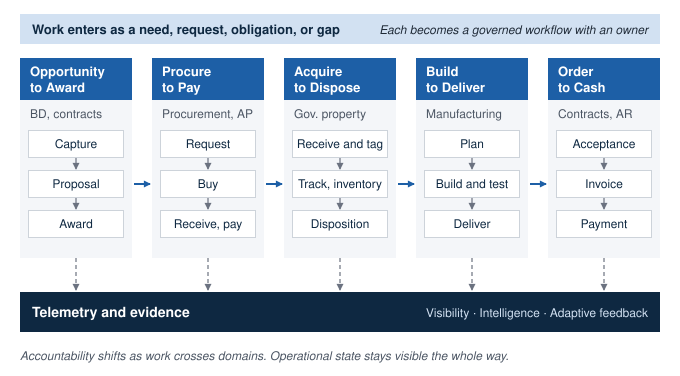
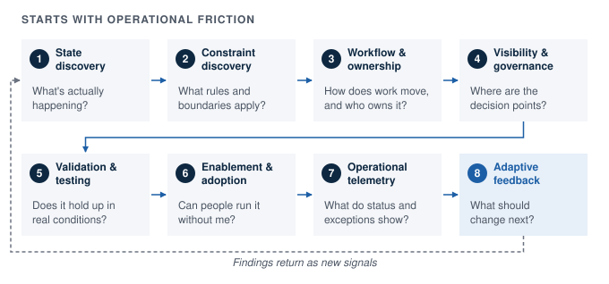
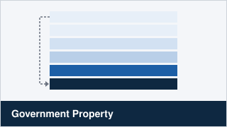
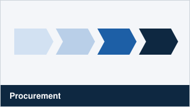
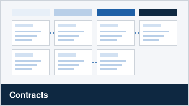
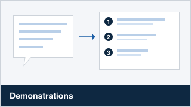
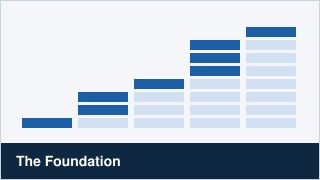

[Portfolio home](../README.md) · [Systems](../README.md#featured-projects) · [Demonstrations](../02-demos/README.md)

# Operational Topology

Operational topology is how the moving parts connect. Without it, people stay busy but the organization can’t see what’s happening, who owns it, or what changed.

---

## System Map

The diagram below shows how operational work moves through connected layers.

---

## How the Work Moves

Work starts as a need, request, obligation, or gap, and becomes a governed workflow with an owner, documentation, and evidence. As it crosses domains, accountability shifts, but it doesn’t disappear into inboxes or memory.

### Adaptive Feedback

When something breaks, repeats, or gets flagged in an audit, it becomes a signal. That signal updates policy, workflows, training, templates, or AI guidance, so operational failures become system updates.

Telemetry makes this possible: systems can’t improve if their current state is invisible.

## **How Systems Are Designed**

Systems do not begin with technology. They begin with friction: repeated work, unclear ownership, hidden dependencies, or knowledge held by one person. The first goal is understanding how work actually moves.

The goal is not simply to automate a task. The goal is to create systems that maintain state, preserve context, operate within constraints, and improve through feedback.

## Connected Systems

Built across Fortune 500 enterprises, high-growth startups, small businesses, and audit-sensitive federal environments.

[**Adaptive Government Property System**](../01-projects/property/README.md)

Compliance operating system for audit-sensitive federal environments.

[Procurement Operating Model](../01-projects/procurement/README.md)

Intake-to-receipt workflow that turns purchasing into a measurable process.

[Contract Lifecycle Orchestration](../01-projects/contracts/README.md)

Connected system, with every action linked and traceable from opportunity to closeout.

[Demonstrations](../02-demos/README.md)

Smaller demonstrations showing how AI-assisted guidance can support evidence review, escalation logic, and audit-sensitive reasoning without jumping to unsupported conclusions.

[The Foundation](../04-foundation/README.md)

The patterns throughout this portfolio predate modern AI.

---

[View this story in the visual portfolio](https://courtneypetersonchapman.notion.site/topology).

## Diagrams and resources

| Diagram | What it shows |
| --- | --- |
| [Operational topology](assets/operational_topology.svg) | How work enters, moves through a governed workflow, and returns as adaptive feedback |
| [Value streams](assets/topology_streams.svg) | Five connected operational streams above telemetry and evidence |
| [Design flow](assets/design_flow_diagram.svg) | Eight steps from operational friction to adaptive feedback |
