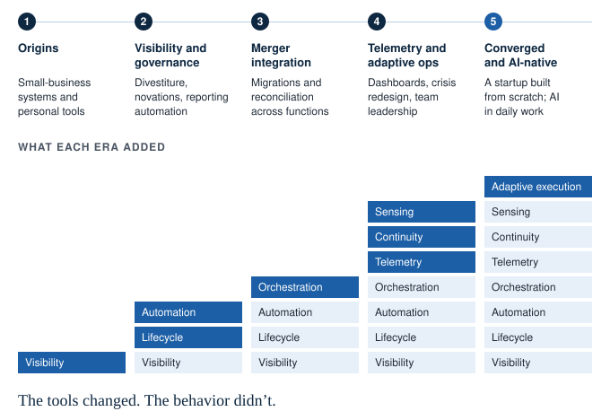
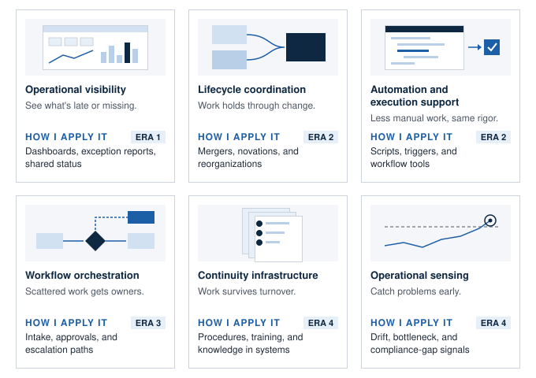
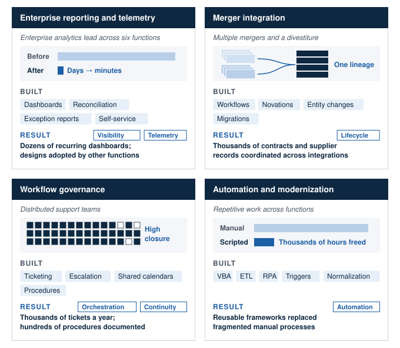

[Portfolio home](../README.md) · [Operational topology](../03-topology/README.md)

# The Foundation

These earlier projects show that the pattern came before the tools.

Long before modern AI, the same problems kept appearing: scattered work, unreliable reporting, processes that depended on individuals, and leaders who couldn't see what was actually happening.

<aside>

The goal never changed: make operational reality visible, coordinated, and easier to improve.

</aside>

---

## Timeline

Each era added a pattern that still runs through the portfolio today.

---

## Patterns That Kept Repeating

They showed up in small-business operations, an enterprise divestiture, merger integrations, crisis response, and a startup built from scratch.

---

## Earlier Examples

Built across Fortune 500 environments, merger programs, and audit-sensitive operations, often with limited tools and shifting org structures.

---

### How This Connects

The pattern layer behind the portfolio: the structures in this work were built and tested long before AI.

Explore →

[Operational Topology](../03-topology/README.md)

---

[View this story in the visual portfolio](https://courtneypetersonchapman.notion.site/foundation).
